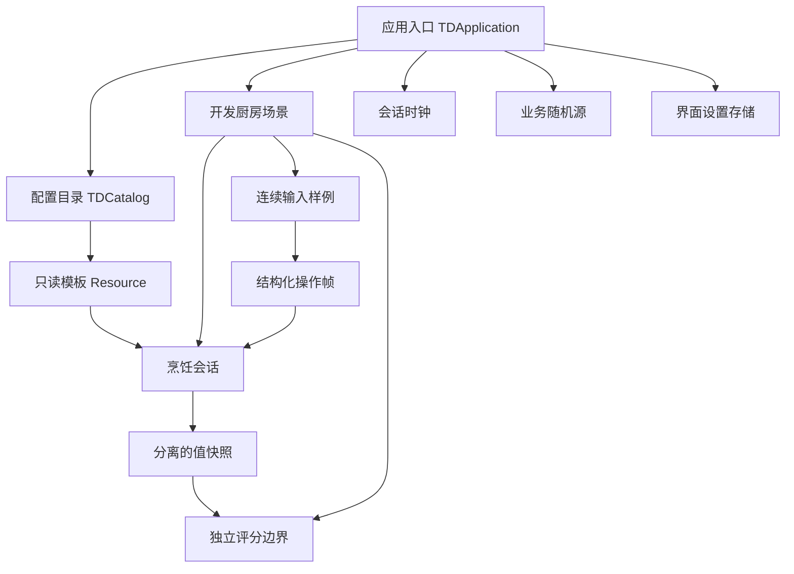

# 项目架构与接入边界

## D039：住所、方向与音乐

GameProfile的schema4追加residence v1（cottage_bed锚点及稳定地块）。TDTownMap负责验证/安装住宅覆盖层，保留底层地图、道路及产权；旧档分配位置在验证阶段完成可行性检查。GameShell装配TDCottageWorld，拥有旅行、日结和保存策略；小屋只发送rest/town意图，不修改Shop或存档。场景碰撞层隔离，隐藏/暂停/弹窗均关闭对应输入。

TDKitchenPlayer统一四向外观TDChefArt及朝向判断。餐厅保留原逻辑网格与真实碰撞，通过逆投影把屏幕输入转换成逻辑速度，补外边界；Town只取朝向相邻格，不再按固定邻居顺序猜建筑。厨房原公共输入助手也必须转向工作台。

TDGameMusic由GameShell持有，播放休闲/营业曲；真实厨房和研习共用FullKitchen内连续烹饪音轨，只有可见活动谱面才发声。TDBeatAudio的旧点击生成器仅保留校准/旧测试，正式厨房用原创音轨；循环端点按音频帧数而非压缩字节数计算。没有新增Autoload，音频合成只发生在离线素材工具。

## D038：经营成长

TDLevelProgression为纯规则RefCounted，持有等级/日游标/最多28日日结明细/奖励与持久事件；独立于Shop钱账和Research灵感账。Profile将Shop完成日结的day_settled信号接到一次性等级结算，读取WorldEconomy税后利润及店铺属性，以候选Level/Research一起验证并提交内存；Research候选通过无save_sink的隔离实例调用既有grant_inspiration，不递归触发整包保存。之后同一profile schema3通过既有临时文件/读回/备份写盘，失败保留可重试的完整内存状态。

GameShell完成日结保存后显示升级提示；餐厅账本进入TDLevelRewardsView，只读取快照。HUD显示等级。规则输入支持稳定store_id、scale_milli和店铺指标前后值，目前Profile只适配真实主店；正式分店需在同日汇总此接口，不能把旧独立世界分店账接来重复算钱。pending_level_events/acknowledge_level_event提供持久投递与显式确认；事件消费者必须按ID幂等，权益查询不代表家具已经生成或剧情已播放。

## D037：批次库存与熟练制作

TDFoodStock为无节点批次函数，Shop.inventory数量仍是权威账，inventory_lots逐项校验和其一致；原料出库把到期日传给CookingModel，portable_data跨砧板/锅/冰箱带回，不更改模板。GameProfile给旧工厂装配公开的可供货清单与商品信息，正式和调试世界不混账；图标抽取为TDIngredientIcon供工厂/集市/冰箱/M6复用。

CookingQTE只提出累计倒入请求，CookingModel按operation+hold身份计量并调用Shop.consume_materials，实际返回量决定风味；结束时核对已扣量，不重复扣。inflight_materials是只读当前工序在途消耗，ShopView计算订单余料时扣除，避免流式扣料导致误售罄。所有时间仍来自TDClock。

Shop按合法手工成品的模块performance_score累积mastery，顾客满意度保持独立。CookingLane自动模式驱动同一BeatSheet/Controller/Model执行切配与烹调，按配方流式倒料、生成可交付成品；节点不直接制造高分，也不跳过真实耗时。模板、批次、手艺与配置通过正式槽保存；只在既有日边界写盘。

## D036：五镇社会经济

TDGameProfile继续持有唯一Shop钱包并装配TDWorldEconomy。后者组合TDCommunitySociety（320家庭、工资/生活/预留/公共部门）、TDCommunityBank（有限储备、存款负债、贷款/利息）及TDBusinessExpansion（产权/投资/工期）；均为无节点规则对象。没有新增Autoload或后台线程，远镇不实例化场景，每日集中推进。

建筑线增加commercial_parcels/apply_commercial_occupancy：在已有商业街/竞品区分出明确单元、内部步道并显示产权，不重新生成玩家已有住房或侵入厂地。远镇新经济地图的build_economic_layout以固定种子有界排除断路布局；同入口用于初次创建与存档几何校验。经济规则只消费建筑快照，集成入口做存档与地图适配；厂商生产仍由既有实现负责。商路剧情仍只调用recommend_route，不实现新剧情。

旧13镇经济schema1经校验迁移为schema2：活动市场仅成都/巴黎/东京/曼谷/墨西哥城，停用市场留只读档案，已付运输继续兑现；旧地图/主店/菜谱不搬迁。外部就业及基本生活按明确对手流量开放结算，不声称模拟所有产业的一般均衡。

## D030：菜谱研习切片

主入口装配图谱视图、研习会话、独立存储和现有世界会话。D031中图谱用屏幕CanvasLayer覆盖原场景，逐节点保存/恢复处理模式并调用既有时钟暂停接口；不销毁订单或重建厨房。B/返回关闭覆盖层，当前筹备菜单增量接入新解锁。

TDResearchSession拥有资格和保存事务；D032暂不消耗游戏小时，旧study_hours仅保留历史统计。TDResearchLesson仅装配一间隔离的TDFullKitchen并自动提供练习原料，真实转移备菜并开始外置逐拍表。TDCookingLane、TDBeatSheet、TDCookingQTE、TDGuidedCookingView仍负责原厨房的全部判定、状态与画面。TDResearchTrialView负责取消/结算展示，失败重试发意图到Atlas，再调用同一begin建立新会话，不能提交任意成绩。TDCookingSession.module_scores()提供模型既有只读模块结果，研习按其权重汇总。

图谱与关卡关联权威为content/research/recipe_atlas.json；kind=kitchen、version=2引用真实recipe_id与primary。TDResearchRuntime显式装配三道最小厨房增量，HTML原始100图标直接复用。独立user://research-v1.json保持格式1与历史合法解锁；完整世界档仍在后续范围。

剧情通过稳定事件ID开放菜系/奖励。UI按钮和公开选择方法共同限制未开放菜系；选择高亮与真实掌握连线独立。未编写正式剧情或其余98关，旧四轨生产入口已移除，现有营业QTE默认行为保持。

## D035：正式单店与世界经济

TDGameProfile是装配与交易边界：Shop拥有正式现金、厨房库存、订单；World保留建筑、原料厂和既有世界字段；WorldEconomy拥有公共市场、NPC商家/意向、区位、运输与费用。只保存同一个六槽包，不建立新Autoload或第二个玩家钱包。D021世界实验仍可独立调试，不参与正式店双重结算。

经济选择由纯函数TDEconomicDemand计算；画像TDEconomicCustomer与本次TDMealIntent分开。TDEconomicGeography使用地块快照、单格稀疏覆盖、只读按需缓存，无每格Node。当前逻辑网格尚不是TileMap：未来TileSet custom data可提供静态地表默认，动态单格记录仍以town:x:y独立索引（同一tile资源不能承载所有放置位置的独立租金）。移动/真实寻路依然由地图线负责，目前经济路程是显式可替换的区域估计。

TileSet默认数据的共享行为依据[Godot官方说明](https://docs.godotengine.org/en/stable/tutorials/2d/using_tilesets.html#assigning-custom-metadata-to-the-tileset-s-tiles)，实际API以dependencies.lock.json的引擎执行结果为准。

世界市场13镇按日更新，当前店按12片分配有限用餐机会；只有来店顾客进入已有餐厅呈现。远端NPC用库存/现金/容量约束的聚合餐馆，不创建远端Godot场景。复用已有QTE和独立食品评分，新增活跃工位秒只读信号用于水电；研究与剧情商路分别开放。

现有供应与建筑模块无需依赖WorldEconomy：集成层调用只读quote/cell/forecast及事务结果。具体字段、幂等和存档迁移见CONTRACTS的D035；经济模块不会直接改建筑或厂商库存。可执行独立检查为`tools/check.ps1 -Suite commerce`，长跑为`tools/economy_simulate.gd`，真实厨房联调另由game套件覆盖。

## D021：小镇客流（历史实验入口，正式入口已被D033/D035覆盖）

`TDApplication` 持有一份 `TDPhase3Session`，分给 `TDTownWorld` 和 `TDRestaurantWorld`。会话拥有目录、地图、供货、菜谱解锁、竞品、当天 NPC、迎宾/收银是否在岗，以及一份原料账。公式在 `TDEconomyMath`，保质期在 `TDPantry`，不放进界面。界面只发下一天、改价、开关功能区、接单、拒绝、上菜、雇用、按菜备料和点选食材。

小镇镜头是跟随玩家的 `TownCamera`，视野比整张地图小。功能区按配置里的宽高占多格，十字路本身仍然只占一格宽。餐厅碰撞和寻路仍在原来的直角网格里。`TDRestaurantIsoView` 只负责把同一坐标画成地面菱形和两面墙，并按鼠标反算格子。没有新的 Autoload。Phase 2 的现金账仍分开。学会的新菜在进入营业时由 `TDKitchenLink` 装进现有 `TDServiceCatalog` / `TDFullKitchen`，走原来的逐拍表，不另建一套做菜流程。

## D020：自由备菜与探索（当前入口）

仍沿用ShopView→FullKitchen→Handling/Lane→CookingSession/Model，未建立另一套演示流程。世界通过station_action发E/F/Q意图，锅的材料泡读取已有快照，切型弹窗只选谱，自动烹饪顺序不变。

ShopSession新增已解锁集合及冷藏实体清单。原料数值库存与已取出的冷藏实体分开，取回不退款不重置材料；可售量计入两者，实体ID去重。Model.transfer_to能移动冷锅中的指定食材和对应工序；开始加工后拒绝拆回。冷藏包保存真实切配输入和受校验的暴露/反应/属性，恢复不再随机判伤或重复氧化。冷藏期间暂停食材暴露为ASSUMPTION，本轮无保鲜/腐败系统。

菜谱由实际主料集合+炒/蒸方法识别。顾客只影响已知菜的烹饪要求/调味目标，菜板选型由玩家决定。数据库内锁定汽锅鸡可照谱尝试；出锅观察真实步骤Perfect与缺项后解锁，独立于客人评分。未知组合复用相同自动链，M6提供有限自由长按窗口，成品显式failed_dish。

锅内气泡及可售检查复用快照；温度变化不再逐帧触发整队库存分配。垃圾桶通过原会话取消/清理，旧回调不会作用于新锅。没有新Autoload。

## Phase 2：营业装配（D019，当前入口）

D019当前路径：单一冰箱→独立实体食材→菜板按顾客要求打谱→任一锅自动加工→出餐匹配最早同菜。ShopSession拥有库存/队列/钱，CookingModel通过注入的material_sink在加料前整笔扣库存，搬运不扣料。顾客要求生成会话独立目录，菜品家族ID不变；实际菜品和Scorer继续分离。超时不销毁食物，日结才清理现场。原ShopView中的手动选单、分锅及预付款路径已移除。

下述D017装配说明保留历史背景；订单绑定、指定锅、超时清理与预付款均以上段和CONTRACTS D019为准。

TDApplication → TDShopView → TDShopSession / TDShopStore / TDServiceCatalog，并装配原 TDFullKitchen。新开/继续/退出是玩家入口，历史厨房仍可单独开发验证。没有新增Autoload，没有平行烹饪模型。

规则层拥有库存、金钱、订单、日期与指标；内容层将营业增量显式合入既有只读目录；Store只在边界校验和保存。ShopView负责订单到锅/手持/菜板的归属及意图路由，不能写规则字典。Lane仍拥有真实QTE，Session拥有菜品，Scorer只读成品与客人要求。依赖方向和数据单位见CONTRACTS、systems/business.md。

实际像素厨房按比例复用；新增筹备/日结页和订单侧栏。食材架E选当前订单的主料、砧板按谱备菜、指定锅自动加工、实体端盘出餐。顾客用订单卡呈现；本阶段不增加餐厅寻路或员工AI。营业事件边界注入厨房时钟，先处理超时再允许后续操作结果；取消同时释放订单对应的菜板/手持/锅状态。

以下为前序阶段历史架构，阶段入口与经营存档以本节为准。

## D016：菜谱谱面与交互反馈

继续复用上述模块。菜谱定义食材到备菜谱的引用，便携会话携带目标recipe_id；Handling接收入口传入的菜谱，Lane据此查谱，不再固定调用全局六刀。当前番茄炒蛋是默认制作目标；蒸蛋采用相同的番茄切块要求，其他谱可在配置中替换。

QTE对象拥有音符判定事件和递增序号；Lane缓存分离事件及短音，GuidedView展示文字/颜色/判定音符，并用成功落刀事件驱动刀动画。重复读取不再播放或改变状态。长按有预告、起手期限、从真实按下起算的蓄力期限，UI和判定共享held_sec。

FullKitchen按所有锅的真实事件边界切分推进，在M6开始/结束边界装配鼠标预约；被让出的连续控制保持当前位置和热量积累，但不纳入稳定率评估。它不暂停游戏时钟，也不授予自动成功。Lane和规则层仍不依赖跨场景节点路径，无新增Autoload。

## 当前D015：自动流程与玩家视图

仍由TDApplication装配同一个TDFullKitchen、Handling、菜板和双锅Lane。新增TDGuidedCookingView是只读呈现，不是平行烹饪模型：世界E交互→真实会话转移→外置逐拍表→原QTE→模型提交→独立评分→评价卡。

普通菜单只有进入厨房/退出，工序页只有背景动作、QTE与规定HUD。旧自由工序视图隐藏，旧模型与独立dev入口保留兼容验证，不再从玩家菜单暴露。使用已有像素厨房背景/角色；食材与砧板覆盖绘制在背景台面坐标，交互点在台前；出餐岛台有柜体、台面和实际碰撞。

TDBeatSheet编译真实输入时间线，允许Rest、手鼠并行、非等间距重排及首拍预备拍；Lane只发合法操作请求，并在事件/完成边界切分长帧。两轨仍各自完成一次，模块评分不按段数重复加权。Lane缓存自己的只读配置副本，避免每帧复制整份内容；快照继续分离。

渲染工具为tools/guided_visual_check.gd；test_guided_kitchen是真实生产入口集成（自动搬运、自动工序、双锅、蒸菜、离开炖煮、重新进入），没有替身代替规则或QTE。工程证据与玩家验收分开。

## 操作与搬运增量（D014历史基线）

TDApplication → TDFullKitchen装配世界、TDKitchenHandling、菜板Lane与两个锅Lane。世界只发稳定功能位ID；Handling持有手上/菜板对象的所有权，模型负责跨会话原子转移。备料转入锅后不留下另一份可变副本，端盘携带的就是实际锅会话。右侧蒸笼使用右锅槽，不创建第三份并行菜。

根厨房拥有共享拍钟和循环节拍音轨；每Lane有独立游戏/QTE时钟、业务随机与扰动随机。TDBeatSheet只调度操作请求，仍调用真实会话与QTE，不发预制分数。单锅可同时运行温控与手部操作，各自operation_id去重、取消和提交；根入口分配键盘/共享鼠标，TDTemperatureView只读显示。

数据依赖保持为厨房→QTE/会话→快照→独立评分。TDCookingQTE输出成功刀向、实际调料事件、控温剂量；模型应用效果和反应；UI没有最终评分写权限。无新增Autoload或经营模块。旧独立原型和legacy控制测试继续保留，但生产菜单始终进入PC流程。

长帧在节拍表事件/操作终点分片，连续控温在绝对240Hz格上积分；主动暂停/失焦冻结共享拍钟、音轨和所有会话，并解除输入吸引。返回世界不暂停，炖煮与冷却继续，世界HUD显示剩余时间。新音轨在界面构造完成后启动，避免初始化时间挤占首拍；物理设备同步仍待测试。

## D013完整系统架构（历史基线，操作增量以上述为准）

TDApplication → TDFullKitchen → TDKitchenWorld / 两个TDCookingLane。每条Lane拥有独立CookingSession、TDClock、业务随机源和QTE随机源；输入由FullKitchen唯一分配。世界只发灶台身份，界面打开/关闭不重新建会话。没有新增Autoload。

TDCookingSession保留已验收v1/v2，v3委托TDCookingModel；唯一当前内容是content/cooking_system.json，经TDCookingCatalog验证。TDCookingQTE只计算操作表现，CookingModel只提交菜品效果，CustomerScorer只读六属性及声明需求。TDRecipeLibrary只存方案，TDCookingActionView与TDPlatingView只显示或发送意图。完整契约和建议规则见[systems/cooking.md](systems/cooking.md)。

业务随机与QTE扰动分开；画面无业务随机依赖。每次重做相同种子可复现，两个槽位种子不同；输入事件先同步单调时钟，再路由唯一槽位。操作ID包含会话代次，旧输入和结果不能命中新操作。长帧在QTE结束边界切分，浮点比较采用1e-9至1e-5容差；不以帧数判断节奏。暂停冻结音轨/游戏/QTE，失焦同处理，恢复需新按键。

## 旧番茄炒蛋原型（历史）

TDApplication仍是唯一装配入口，主菜单进入TDCookingKitchen；旧探针保留模块测试按钮。TDRecipeCatalog校验唯一活动原型配置，原TDCookingSession增加v2模式保存独立食材/工序；原CustomerScorer实现真实只读评分，没有另建平行框架。

依赖：应用→内容/厨房/时钟/评分；厨房→QTE/会话；QTE→请求/时钟→结构化结果；会话→快照；评分只读快照与顾客声明。TDBeatAudio是厨房局部节点，无新增Autoload。

加入、切菜、调味、加热、出锅顺序生效；切菜/加热完成才提交，取消不提交。厨房在完成边界切分时间，先提交再推进余下冷却，避免帧率决定结果。温度投影从食材风味派生，快照/重复评分不叠乘。H是本菜外置关系加成，不代表世界完整相生相克系统。

本菜无业务随机；保留原有随机注入能力及测试。InputMap输入处理前同步Time.get_ticks_usec；测试关闭automatic_time后注入相同秒时钟。音轨启动延迟来自AudioServer估计，视觉拍点与QTE共用修正后拍点。暂停冻结音轨、游戏/QTE，失焦执行同策略，恢复清按住且火力回配置基准。

音频依据：[Godot4.7同步说明](https://docs.godotengine.org/en/4.7/tutorials/audio/sync_with_audio.html)、[AudioStreamPlayer](https://docs.godotengine.org/en/4.7/classes/class_audiostreamplayer.html)。教程标注尚未全面更新到4.7，所用API已在锁定4.7.2实际运行。WASAPI混音捕获不能证明物理设备延迟或手感。

当前不含旧计划的五类QTE、双菜、摆盘、自建菜谱、SAN。以下Phase0历史部分的未来计划已被最新范围覆盖。

## Phase 0 历史基线

本阶段实现的是可供后续开发复用的框架及 DEV_ONLY 连续输入样例。完整做菜为 Phase 1 v2，不能把样例验收当作完整烹饪验收。

## 装配与依赖

无 Autoload。入口持有目录与设置，创建场景前显式注入时钟、随机源、评分器、身份。厨房持有会话与QTE并转发意图；不通过父级绝对节点路径索取依赖。规则对象为 RefCounted，Node 负责输入、生命周期和显示。

| 模块 | 所有权 / 职责 | 不允许的依赖 |
|---|---|---|
| 内容与配方 | 唯一来源 content/dev_samples.json；校验后生成模板，每次查询重新构造嵌套 Resource | 不读UI或会话，不直接把towns解释成数值 |
| 烹饪核心 | 每个会话独立持有值数据、版本、状态、处理量；校验请求/帧，终态发一次结果 | 不依赖QTE场景、UI、评分、经济 |
| QTE | 接收时间、随机和输入样本，提供持续进度/终态帧 | 不改菜品或金钱，不读取全局业务随机 |
| 独立评分 | evaluate(snapshot, expectations)边界已实际调用，当前返回NOT_IMPLEMENTED | 不回写菜品；不编造分数 |
| 厨房集成 | 显式路由输入、驱动时钟、交给会话验证、展示结构化结果 | 不直接修改规则状态，不决定收益 |
| 应用入口 | 菜单、场景装配、进出重开、暂停、设置读写 | 不写烹饪算法，不扩张成万能Manager |

## 当前真实通路

1. 主入口载入并校验 active 列表；非法配置显示来源与字段，不进入厨房。
2. 进入厨房生成 session-N、新代次、新时钟与独立随机源，再从模板复制值状态。
3. 点击开始构造操作请求；会话合法转移 ready→running，QTE从配置区间采样一次目标。
4. 空格（InputMap）或按住按钮形成相同 TDInput；每次时间推进输出累计帧，烹饪核心按真实有效按住时间×配置速率更新处理量。
5. 达标/超时由QTE返回终态，会话只接受一次；显示输入时长和结果。评分边界返回NOT_IMPLEMENTED，没有隐藏高分。
6. 退出/重开释放输入、取消旧控制器、断开会话信号、移出旧节点，再装配新场景。旧身份/代次不能影响新会话。

样例的“处理量”单位是开发用 work unit，不是正式细碎度、口味、完成度或搭配度。没有实现五类正式QTE。失败可以重试，不是正式经济惩罚方案。

## 时间、输入与暂停

- TDClock.advance(delta_sec)可手动驱动；real_sec持续累计；game_sec与qte_sec正常同步推进，暂停只停后两者。增量必须有限且非负。
- 使用显式累计秒与持续强度[0,1]，不按渲染次数加分；长帧截在达标或超时边界，分片等价有测试。
- 根入口与厨房设置PROCESS_MODE_ALWAYS，使暂停菜单和实际时间仍工作；规则更新额外受clock.paused和厨房暂停门控。将来普通世界节点可按SceneTree暂停。
- 暂停与失焦清除按住状态；恢复要求新按下，拒绝自动重复键。R重开，Esc暂停。音频时间源/设备校准未实现，不宣称已与音乐对齐。
- 测试用Input.parse_input_event并刷新缓冲，经过真实SceneTree输入传播；这证明引擎路由，不能代替真实键鼠设备/延迟试玩。

## 后续接入

Phase 1 在此基础上增加食材运行实例、六属性、Modifier、五类QTE、双菜、摆盘、自建菜谱与烹饪侧SAN；保留会话/操作身份、显式时间随机依赖、结果去重语义，契约可增版本。
Phase 2库存通过供料/消耗适配器与烹饪边界交互，经济订阅唯一成品交付事件，评分器只计算，界面不重复扣料/发钱。
员工、世界、剧情仅在后续阶段接入配置和事件边界，本阶段没有空壳模块。

## 工具核实来源

- Godot 4.7 InputMap和真实事件传播：[Input文档](https://docs.godotengine.org/en/4.7/classes/class_input.html)
- 暂停与process_mode：[暂停文档](https://docs.godotengine.org/en/4.7/tutorials/scripting/pausing_games.html)
- 模板资源和复制语义：[Resource文档](https://docs.godotengine.org/en/4.7/classes/class_resource.html)。本工程对嵌套Resource显式重建，值容器再深复制，配隔离测试。
- GUT 9.7.1对应Godot 4.7：[维护者版本表](https://github.com/bitwes/Gut)。已下载并验证版本，锁文件记录archive SHA256；不使用浮动main。

## D033 当前正式游戏装配（2026-10-23）

以上 Phase 0 内容保留为历史；本节描述当前入口。

- `TDApplication` 装配 `TDGameShell`。正常菜单只开始/继续/载入/设置/退出；旧原型方法留作自动测试与独立 debug 工具。`--validation-root=<绝对路径>` 将检查进程的设置与存档全部重定向，导出冒烟检查不读取玩家档。
- `TDGameProfile` 一槽一实例，拥有 `TDShopSession`、`TDPhase3Session`、`TDResearchSession` 和持久 `TDRestaurantLayout`。正常经营的金额（分）、库存（千分份）、订单、评价、日结全部由既有 Shop 规则决定；World 不再独立收取另一笔订单收入。世界消费通过 profile 的事务适配器把元转换成分，并写入营业明细，保留零钱；失败恢复世界快照。
- Town / Restaurant / 嵌入的 ShopView 同时存在，场景往返切显示、摄像机和输入，不重建做菜或订单对象。厨房在餐厅中仍推进营业时间；离开店铺仅 PREPARE/SETTLED 可用。餐厅实体客人是现有订单的投影，没有第二套接单/付款状态。
- 世界物件发意图：门→travel，摊贩→buy，营业牌→set_menu/open_day，账本→summary/save，装修桌→原布局工具，菜谱架/B→原 Atlas，休息处→save/next_day。供应处复用 SupplyBook 的到货时间；已到货以单次账目入厨房库存。旧员工、分店、伪评分及客流试验仍在独立 debug 场景，不作为本轮已整合的正常单店功能。
- 研习购买/成绩先通过 save_sink(candidate) 保存完整候选槽包才发布；营业做菜奖励留在本槽内存，与营业边界一起保存。新档不会读取独立的全局研究档。旧营业/研究只经用户点击显式导入空槽，原文件不改；按已确认稳定 ID 安装历史菜谱定义，不把定义安装当解锁。
- 槽包包含 schema_version、kind、slot_id、title、updated_at、revision、shop/research/world/layout。复用既有校验→临时文件→读回校验→备份→替换链；加载先校验全部领域，再装配。未知版本、损坏与槽ID不符均拒绝。研究旧 token 与关闭后的 profile 回调不再能提交。
- 暂停菜单/失焦冻结厨房与营业，Atlas 暂停底层分支后使用自己的真实厨房练习时钟。文本输入不抢移动/研习键，控制台必须输入 debug 才执行调试命令；进入旧试验入口前要求营业结束，并保存/关闭当前槽。
- 美术采用 assets/town 的生成 PNG 与既有厨房/厨师资源，图集原生切片、nearest 采样。布局仍可编辑，画面不代替路径、阻挡或库存逻辑。
- 标题开始入口按TDProfileStore.latest直入最近成功保存的有效槽；无有效档选择首个真正空槽。创建/读取呈现进度并拒绝重复请求，初始化失败先返回结构化错误。TDIngredientBook只读content/ingredient_index.json运行身份索引，tools/build_ingredient_index.ps1显式从只读来源提取并检查一致；生产运行不再读取doc/source。
- 同时存在的Town/Restaurant/Kitchen使用独立物理层（掩码墙体/人物：16/32、4/8、1/2），隐藏不等于移除碰撞，不能再共用墙体层。餐厅is_walkable由边界和真实阻挡家具决定，空功能区地砖可走；寻路和StaticBody生成同源，家具服务落脚规则仍保留专用过道。IsoView用脚底投影定位人物，并按地面位置排序人物/家具，原存档和位图不改变。
