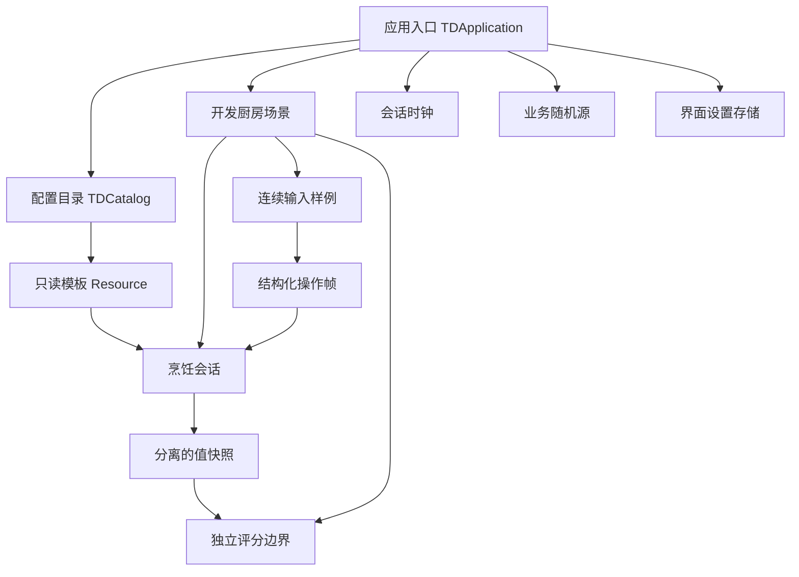

# 项目架构与接入边界

## Phase 2：营业装配（D017，当前入口）

TDApplication → TDShopView → TDShopSession / TDShopStore / TDServiceCatalog，并装配原 TDFullKitchen。新开/继续/退出是玩家入口，历史厨房仍可单独开发验证。没有新增Autoload，没有平行烹饪模型。

规则层拥有库存、金钱、订单、日期与指标；内容层将营业增量显式合入既有只读目录；Store只在边界校验和保存。ShopView负责订单到锅/手持/菜板的归属及意图路由，不能写规则字典。Lane仍拥有真实QTE，Session拥有菜品，Scorer只读成品与客人要求。依赖方向和数据单位见CONTRACTS、systems/business.md。

实际像素厨房按比例复用；新增筹备/日结页和订单侧栏。食材架E选当前订单的主料、砧板按谱备菜、指定锅自动加工、实体端盘出餐。顾客用订单卡呈现；本阶段不增加餐厅寻路或员工AI。营业事件边界注入厨房时钟，先处理超时再允许后续操作结果；取消同时释放订单对应的菜板/手持/锅状态。

以下为前序阶段历史架构，阶段入口与经营存档以本节为准。

## D016：菜谱谱面与交互反馈

继续复用上述模块。菜谱定义食材到备菜谱的引用，便携会话携带目标recipe_id；Handling接收入口传入的菜谱，Lane据此查谱，不再固定调用全局六刀。当前番茄炒蛋是默认制作目标；蒸蛋采用相同的番茄切块要求，其他谱可在配置中替换。

QTE对象拥有音符判定事件和递增序号；Lane缓存分离事件及短音，GuidedView展示文字/颜色/判定音符，并用成功落刀事件驱动刀动画。重复读取不再播放或改变状态。长按有预告、起手期限、从真实按下起算的蓄力期限，UI和判定共享held_sec。

FullKitchen按所有锅的真实事件边界切分推进，在M6开始/结束边界装配鼠标预约；被让出的连续控制保持当前位置和热量积累，但不纳入稳定率评估。它不暂停游戏时钟，也不授予自动成功。Lane和规则层仍不依赖跨场景节点路径，无新增Autoload。

## 当前D015：自动流程与玩家视图

仍由TDApplication装配同一个TDFullKitchen、Handling、菜板和双锅Lane。新增TDGuidedCookingView是只读呈现，不是平行烹饪模型：世界E交互→真实会话转移→外置逐拍表→原QTE→模型提交→独立评分→评价卡。

普通菜单只有进入厨房/退出，工序页只有背景动作、QTE与规定HUD。旧自由工序视图隐藏，旧模型与独立dev入口保留兼容验证，不再从玩家菜单暴露。使用已有像素厨房背景/角色；食材与砧板覆盖绘制在背景台面坐标，交互点在台前；出餐岛台有柜体、台面和实际碰撞。

TDBeatSheet编译真实输入时间线，允许Rest、手鼠并行、非等间距重排及首拍预备拍；Lane只发合法操作请求，并在事件/完成边界切分长帧。两轨仍各自完成一次，模块评分不按段数重复加权。Lane缓存自己的只读配置副本，避免每帧复制整份内容；快照继续分离。

渲染工具为tools/guided_visual_check.gd；test_guided_kitchen是真实生产入口集成（自动搬运、自动工序、双锅、蒸菜、离开炖煮、重新进入），没有替身代替规则或QTE。工程证据与玩家验收分开。

## 操作与搬运增量（D014历史基线）

TDApplication → TDFullKitchen装配世界、TDKitchenHandling、菜板Lane与两个锅Lane。世界只发稳定功能位ID；Handling持有手上/菜板对象的所有权，模型负责跨会话原子转移。备料转入锅后不留下另一份可变副本，端盘携带的就是实际锅会话。右侧蒸笼使用右锅槽，不创建第三份并行菜。

根厨房拥有共享拍钟和循环节拍音轨；每Lane有独立游戏/QTE时钟、业务随机与扰动随机。TDBeatSheet只调度操作请求，仍调用真实会话与QTE，不发预制分数。单锅可同时运行温控与手部操作，各自operation_id去重、取消和提交；根入口分配键盘/共享鼠标，TDTemperatureView只读显示。

数据依赖保持为厨房→QTE/会话→快照→独立评分。TDCookingQTE输出成功刀向、实际调料事件、控温剂量；模型应用效果和反应；UI没有最终评分写权限。无新增Autoload或经营模块。旧独立原型和legacy控制测试继续保留，但生产菜单始终进入PC流程。

长帧在节拍表事件/操作终点分片，连续控温在绝对240Hz格上积分；主动暂停/失焦冻结共享拍钟、音轨和所有会话，并解除输入吸引。返回世界不暂停，炖煮与冷却继续，世界HUD显示剩余时间。新音轨在界面构造完成后启动，避免初始化时间挤占首拍；物理设备同步仍待测试。

## D013完整系统架构（历史基线，操作增量以上述为准）

TDApplication → TDFullKitchen → TDKitchenWorld / 两个TDCookingLane。每条Lane拥有独立CookingSession、TDClock、业务随机源和QTE随机源；输入由FullKitchen唯一分配。世界只发灶台身份，界面打开/关闭不重新建会话。没有新增Autoload。

TDCookingSession保留已验收v1/v2，v3委托TDCookingModel；唯一当前内容是content/cooking_system.json，经TDCookingCatalog验证。TDCookingQTE只计算操作表现，CookingModel只提交菜品效果，CustomerScorer只读六属性及声明需求。TDRecipeLibrary只存方案，TDCookingActionView与TDPlatingView只显示或发送意图。完整契约和建议规则见[systems/cooking.md](systems/cooking.md)。

业务随机与QTE扰动分开；画面无业务随机依赖。每次重做相同种子可复现，两个槽位种子不同；输入事件先同步单调时钟，再路由唯一槽位。操作ID包含会话代次，旧输入和结果不能命中新操作。长帧在QTE结束边界切分，浮点比较采用1e-9至1e-5容差；不以帧数判断节奏。暂停冻结音轨/游戏/QTE，失焦同处理，恢复需新按键。

## 旧番茄炒蛋原型（历史）

TDApplication仍是唯一装配入口，主菜单进入TDCookingKitchen；旧探针保留模块测试按钮。TDRecipeCatalog校验唯一活动原型配置，原TDCookingSession增加v2模式保存独立食材/工序；原CustomerScorer实现真实只读评分，没有另建平行框架。

依赖：应用→内容/厨房/时钟/评分；厨房→QTE/会话；QTE→请求/时钟→结构化结果；会话→快照；评分只读快照与顾客声明。TDBeatAudio是厨房局部节点，无新增Autoload。

加入、切菜、调味、加热、出锅顺序生效；切菜/加热完成才提交，取消不提交。厨房在完成边界切分时间，先提交再推进余下冷却，避免帧率决定结果。温度投影从食材风味派生，快照/重复评分不叠乘。H是本菜外置关系加成，不代表世界完整相生相克系统。

本菜无业务随机；保留原有随机注入能力及测试。InputMap输入处理前同步Time.get_ticks_usec；测试关闭automatic_time后注入相同秒时钟。音轨启动延迟来自AudioServer估计，视觉拍点与QTE共用修正后拍点。暂停冻结音轨、游戏/QTE，失焦执行同策略，恢复清按住且火力回配置基准。

音频依据：[Godot4.7同步说明](https://docs.godotengine.org/en/4.7/tutorials/audio/sync_with_audio.html)、[AudioStreamPlayer](https://docs.godotengine.org/en/4.7/classes/class_audiostreamplayer.html)。教程标注尚未全面更新到4.7，所用API已在锁定4.7.2实际运行。WASAPI混音捕获不能证明物理设备延迟或手感。

当前不含旧计划的五类QTE、双菜、摆盘、自建菜谱、SAN。以下Phase0历史部分的未来计划已被最新范围覆盖。

## Phase 0 历史基线

本阶段实现的是可供后续开发复用的框架及 DEV_ONLY 连续输入样例。完整做菜为 Phase 1 v2，不能把样例验收当作完整烹饪验收。

## 装配与依赖

无 Autoload。入口持有目录与设置，创建场景前显式注入时钟、随机源、评分器、身份。厨房持有会话与QTE并转发意图；不通过父级绝对节点路径索取依赖。规则对象为 RefCounted，Node 负责输入、生命周期和显示。

| 模块 | 所有权 / 职责 | 不允许的依赖 |
|---|---|---|
| 内容与配方 | 唯一来源 content/dev_samples.json；校验后生成模板，每次查询重新构造嵌套 Resource | 不读UI或会话，不直接把towns解释成数值 |
| 烹饪核心 | 每个会话独立持有值数据、版本、状态、处理量；校验请求/帧，终态发一次结果 | 不依赖QTE场景、UI、评分、经济 |
| QTE | 接收时间、随机和输入样本，提供持续进度/终态帧 | 不改菜品或金钱，不读取全局业务随机 |
| 独立评分 | evaluate(snapshot, expectations)边界已实际调用，当前返回NOT_IMPLEMENTED | 不回写菜品；不编造分数 |
| 厨房集成 | 显式路由输入、驱动时钟、交给会话验证、展示结构化结果 | 不直接修改规则状态，不决定收益 |
| 应用入口 | 菜单、场景装配、进出重开、暂停、设置读写 | 不写烹饪算法，不扩张成万能Manager |

## 当前真实通路

1. 主入口载入并校验 active 列表；非法配置显示来源与字段，不进入厨房。
2. 进入厨房生成 session-N、新代次、新时钟与独立随机源，再从模板复制值状态。
3. 点击开始构造操作请求；会话合法转移 ready→running，QTE从配置区间采样一次目标。
4. 空格（InputMap）或按住按钮形成相同 TDInput；每次时间推进输出累计帧，烹饪核心按真实有效按住时间×配置速率更新处理量。
5. 达标/超时由QTE返回终态，会话只接受一次；显示输入时长和结果。评分边界返回NOT_IMPLEMENTED，没有隐藏高分。
6. 退出/重开释放输入、取消旧控制器、断开会话信号、移出旧节点，再装配新场景。旧身份/代次不能影响新会话。

样例的“处理量”单位是开发用 work unit，不是正式细碎度、口味、完成度或搭配度。没有实现五类正式QTE。失败可以重试，不是正式经济惩罚方案。

## 时间、输入与暂停

- TDClock.advance(delta_sec)可手动驱动；real_sec持续累计；game_sec与qte_sec正常同步推进，暂停只停后两者。增量必须有限且非负。
- 使用显式累计秒与持续强度[0,1]，不按渲染次数加分；长帧截在达标或超时边界，分片等价有测试。
- 根入口与厨房设置PROCESS_MODE_ALWAYS，使暂停菜单和实际时间仍工作；规则更新额外受clock.paused和厨房暂停门控。将来普通世界节点可按SceneTree暂停。
- 暂停与失焦清除按住状态；恢复要求新按下，拒绝自动重复键。R重开，Esc暂停。音频时间源/设备校准未实现，不宣称已与音乐对齐。
- 测试用Input.parse_input_event并刷新缓冲，经过真实SceneTree输入传播；这证明引擎路由，不能代替真实键鼠设备/延迟试玩。

## 后续接入

Phase 1 在此基础上增加食材运行实例、六属性、Modifier、五类QTE、双菜、摆盘、自建菜谱与烹饪侧SAN；保留会话/操作身份、显式时间随机依赖、结果去重语义，契约可增版本。
Phase 2库存通过供料/消耗适配器与烹饪边界交互，经济订阅唯一成品交付事件，评分器只计算，界面不重复扣料/发钱。
员工、世界、剧情仅在后续阶段接入配置和事件边界，本阶段没有空壳模块。

## 工具核实来源

- Godot 4.7 InputMap和真实事件传播：[Input文档](https://docs.godotengine.org/en/4.7/classes/class_input.html)
- 暂停与process_mode：[暂停文档](https://docs.godotengine.org/en/4.7/tutorials/scripting/pausing_games.html)
- 模板资源和复制语义：[Resource文档](https://docs.godotengine.org/en/4.7/classes/class_resource.html)。本工程对嵌套Resource显式重建，值容器再深复制，配隔离测试。
- GUT 9.7.1对应Godot 4.7：[维护者版本表](https://github.com/bitwes/Gut)。已下载并验证版本，锁文件记录archive SHA256；不使用浮动main。
