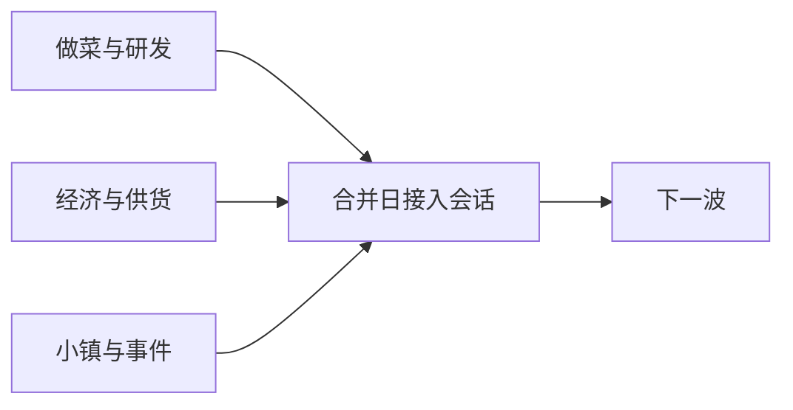

# 分工与集成基线

正式三人规范和工具入口：

- `docs/collaboration/README.md`：角色、分支、工作树、契约、交接、审查和 Definition of Done；
- `collaboration.config.json`：机器可读目录所有权、共享文件和必跑套件；
- `tools/collab.ps1`：配置校验、状态、所有权检查和工作树初始化；
- `docs/collaboration/CURRENT_WAVE.md`：当前波次、负责人和共享锁；
- `docs/collaboration/templates/`：工作单、交接和合并检查单。

下文保留当前 Phase 4 分工和历史协作记录。与上面正式规范冲突时，以正式规范为准；产品范围仍以阶段提示和决定为准。

## 三人并行（2026-10-13）

程序最多三人。三个人固定看三条线，集成的工作按波次轮换，不另设第四个人。任务在 `docs/phases/plan-1013.md`，规则在 D027/D028。下面从 D020 起的段落是历史分工；目录冲突时以 `collaboration.config.json` 为准。

| 线 | 波次中可以改 | 自己的检查 |
|---|---|---|
| 做菜与研发 | `src/cooking/`、`src/qte/`、`src/kitchen/`、`src/scoring/`，以及 `content/` 里的做菜谱和研发图。新测试用新文件，例如 `tests/unit/test_san_substitute.gd` | `tools/check.ps1 -Suite cooking`、`-Suite qte` 和 `-Suite scoring` |
| 经济与供货 | `src/economy/`、`src/business/`、`content/pantry.json`，以及新建的调料、店种、市场配置。新测试单独建文件 | `tools/check.ps1 -Suite business` 和 `-Suite platform`。Phase 2 的钱和 `user://shop-v1.json` 语义保持不动 |
| 小镇与事件 | `src/town/` 里除共享锁文件以外的脚本、`src/restaurant/`、新建的事件配置，以及 `tests/unit/test_floor_service.gd`、`tests/unit/test_restaurant_layout.gd`、`tests/integration/test_phase3_visit.gd`、`tests/integration/test_restaurant_world.gd` | `tools/check.ps1 -Suite service`。Phase 3 的全套规则测试不在这里改 |

共享文件只能由当波集成者在集成工作树按 Contract / Integrate 步骤修改：`src/town/phase3_session.gd`、`src/app/main.gd`、`src/contracts/`、`project.godot`、`content/phase3_world.json`、`tests/unit/test_phase3_rules.gd`、`tests/unit/test_phase4_branch.gd`、`docs/CONTRACTS.md`。`src/town/san_rules.gd` 也算共享，因为现在的出锅概率还在里面；做菜线把入锅规则写到 `src/cooking/` 的新脚本，不直接改这个文件。

集成者按波轮换：第 0 波和第 1 波是小镇与事件，第 2 波是经济与供货，第 3 波是做菜与研发。集成者兼任角色时，在角色工作树也不改共享文件；契约冻结和合并装配只在集成工作树处理。

每天按这个顺序：

1. 开工前写明今天要改的文件。文件落在别人的目录里，就改派或改到自己的新脚本，不直接改。
2. 需要别人调用的类，作者在该波第一天交到自己的目录里，并带上已经通过的测试。调用方从第二天开始接。
3. 界面只发意图。钱、库存、评分和菜名由对应的规则对象改。
4. 下班前跑自己的检查。失败留在自己的测试里修。
5. 合并日另外两人停止改文件。集成者把三个规则对象接进会话和主入口，更新共享测试，再跑 `tools/check.ps1`。没有 pwsh 就记 NOT_RUN。
6. 玩法是否好用仍记 PENDING，直到有人按 `plan-1013.md` 的试玩步骤真的玩过。
7. 提交和推送等用户开口。

三个人同时做时，每人用自己的分支，只包含自己目录里的文件。分支名统一用 `work/<role>/phase-<n>-wave-<n>`，角色 PR 合入 `integration/phase-<n>-wave-<n>`，最后再由集成 PR 合入 `main`。不要在同一个工作目录里同时保存三个人的改动。

人不够三人时，空出来的目录本波不做，不由在场的人顺手改。用户明确改派目录之后，才换人。

第 0 波只用半天，不写玩法。做菜线和经济线各自列出本波要交的函数名和返回值。小镇线把三边都确认过的字段写进 `docs/CONTRACTS.md`，并标明尚未接入。字段名确认之后才开始第 1 波。

第 1 波和第 2 波不要改 `off_menu_chance`。客人改为大多点菜单，是第 3 波的事，到合并日再改 `test_phase3_rules.gd`。

## Phase 5–6 三人延续方式

完整阶段顺序以 `docs/FULL_IMPLEMENTATION_FLOW.md` 为准。Phase 4 完成后仍保留三条线，不重新按文件随意分人：

- 做菜与研发线：正式菜配置、研发图内容、厨师 PK 的做菜入口、低 SAN 重演和做菜反馈；
- 经济与供货线：野采入库、市场、分店模拟、品牌、全球影响力、成就业务事件和存档规则；
- 小镇与事件线：装修、报刊亭、特殊 NPC、节日、市政表现、新手引导和设置界面。

Phase 5 按 5-0 至 5-7 逐单元合并，不允许三个人分别做三个互不连通的小样。共享世界存档、主入口、active 内容清单、事件白名单和 `project.godot` 继续由当单元集成者独占。

Phase 6 不再按功能扩张。三人分别主责：

- 一人维护全量检查、存档迁移和漏洞回归；
- 一人维护目标机、性能、输入音频和长时稳定；
- 一人维护资产许可证、包体白名单、干净构建和发布文档。

任何发布阻断修复仍回到原模块负责人；发布负责人不能在 UI 里绕过规则层补状态。每次修复后先跑受影响套件，再跑全量。

## D020 本轮文件归属与验证入口

主开发/集成角色负责project.godot、ShopView、FullKitchen与共享契约；本轮仅委派grilling要求的只读事实审查，无外部任务/推送。后续烹饪线修改Model/Handling，QTE线修改controller/beat_sheet/GuidedView，经营线修改ShopSession/Store/Catalog；跨线先更新CONTRACTS与AC，再由集成角色验证。

独立检查：tools/check.ps1 -Suite business（含test_kitchen_freedom）、-Suite qte、-Suite service；完整入口不变。新静态方法season_prompt可独立验证UI状态；真实F/Q/E、切型按钮和鼠标长按必须在service场景测试中验证。

## Phase 2当前协作边界

D019延续同一文件归属：本轮只有集成负责人写入。共享新增接口为CookingSession.set_material_sink/select_recipe、Lane.use_recipe_profile、ServiceCatalog.request_profile/material_needs、ShopSession.consume_materials/sync_kitchen/context_for_ingredients/first_order_for。移除旧begin_order/consume_total；业务独测和真实营业入口仍分别使用business/service套件，无新增全局管理器。

本轮仅集成负责人写文件，grilling事实审查Agent只读，无外部任务分派。经营规则负责人可修改 `src/business/shop_session.gd` 和对应规则测试；内容负责人可修改 `service_catalog.gd` / `content/service_content.json`；存储负责人拥有 `src/platform/shop_store.gd` 和中断恢复测试；应用集成负责人拥有 `shop_view.gd`、main、FullKitchen接入、世界显示名、工具、共享契约和导出白名单。角色不是编造的团队成员。

公开接口见CONTRACTS的Phase2部分。独立规则/存储：`tools/check.ps1 -Suite business`；营业真实场景：`-Suite service`；原做菜/QTE/评分套件继续独立运行。生产入口为 `tools/run.ps1`，Phase1独立厨房为 `-FullKitchen`。改变钱料语义或场景连接先改契约与AC，由集成负责人统一合入，再运行全量和真实场景；不让业务UI绕过Session直接改钱料。

Phase2允许最简方案命名保存并上架，覆盖下方Phase1移除配方库菜单的旧范围。旧dev入口与TEST_ONLY内容仍不是营业菜单。下方分工及证据路径是历史索引。

## D016增量分工

本轮集成负责人统一写入；grilling事实审查Agent只读。内容线拥有菜谱preparation_sheets与逐拍行/预告，QTE线拥有cut_actions、last_judgement及长按生命周期；厨房线拥有反馈缓存、菜谱传递和双锅鼠标预约；视图只读取。新增 `test_recipe_performance.gd` 进入qte套件，真实入口仍在test_guided_kitchen。验证使用check.ps1；新版图形证据前缀为artifacts/d016-*，不要混用旧六刀截图。本轮不自动提交或推送。

## 当前D015协作入口

文件归属继续沿用下表角色；本轮只有集成负责人写文件，事实审查Agent只读。规则线追加 `module_scores/steps.module`、真实勾芡材料；内容线管理 `pc_operations.document_sheets/document_weights` 和材料柜；QTE线管理编译后拍点与窗口；厨房/UI线拥有 `guided_cooking_view.gd`、自动功能位路由与M5跨界面HUD。共享场景、主菜单、导出与检查脚本由集成负责人统一修改。

独立入口仍用check.ps1的content/cooking/qte/scoring/integration；本轮专项为 `test_document_operations.gd` 和 `test_guided_kitchen.gd`。图形复现用 `tools/guided_visual_check.gd`，不能拿旧pc_visual_check的自由工序截图充当当前验收。主菜单移除了历史回归按钮，开发者仍可显式用run.ps1的-Module/-Cooking启动旧入口；完整生产流用-FullKitchen。

接口变更核对CONTRACTS的D015部分→边界测试→实现双方→全量检查/真实场景→记录证据。未分派任何外部任务。文档以下描述的自由工序、配方库菜单等为历史基线，当前玩家范围以D015为准。

## 当前D014文件归属

| 工作线 | 本轮公开边界与文件 | 独立验证 |
|---|---|---|
| 规则/内容 | cooking_model.gd的transfer_to/并行结果提交；cooking_catalog.gd与cooking_system.json的PC配置 | check.ps1 -Suite cooking / content；test_pc_cooking |
| QTE | cooking_qte.gd、beat_sheet.gd、temperature_view.gd、cooking_action_view.gd；过程帧与结果，不修改菜品 | check.ps1 -Suite qte；test_pc_operations |
| 世界与厨房集成 | world的稳定station_id；kitchen_handling.gd、cooking_lane.gd、full_kitchen.gd的所有权/输入编排 | check.ps1 -Suite integration；test_pc_kitchen；run.ps1 -FullKitchen |
| 存储/节拍 | recipe_library.gd兼容方案1/2；beat_audio.gd局部循环音轨 | check.ps1 -Suite platform / cooking |

共享配置、世界场景、导出清单、工具及文档由集成负责人统一合入；修改控制器结果字段必须同时修改模型边界测试，不能在视图补写结果绕过校验。上表为角色分工，没有自动向外部派任务。PC集成使用真实Viewport键鼠事件、模型和评分；旧full_kitchen测试显式选择legacy配置作为兼容回归，不替代PC场景验收。图形工具为tools/pc_visual_check.gd，物理设备验收另列。

## 既有分工约定（保留）

当前D013完整系统已采用v3，活动配置是content/cooking_system.json；完整接口见systems/cooking.md。下面旧原型说明仅保留历史。集成负责人拥有src/app、full_kitchen.gd、project.godot、工具和导出；世界/动作工作线分别src/world＋assets/kitchen、src/qte；规则线src/cooking＋src/content；配方库src/platform。独立套件入口已纳入full_*新增测试，完整厨房独立运行`tools/run.ps1 -FullKitchen`。共享接口变更先改systems/cooking.md及边界测试，再由集成负责人统一导入/全量验证。

Phase1增量契约见PHASE1_INTERFACES.md。原型唯一活动数据为content/cooking_prototype.json；dev_samples.json仅供既有探针。content/cooking/qte/integration套件已纳入所有新增测试；评分独立入口为`tools/check.ps1 -Suite scoring`，原型独立运行`tools/run.ps1 -Cooking`。实际菜品评分已完成，旧NOT_IMPLEMENTED只适用于非菜品探针。

负责人均为角色标记，未指定具体团队成员。此文件只约定协作边界，不向外部分派任务。开始多人工作前由集成负责人分配互不重叠文件。

| 工作线 / 角色 | 可修改目录 | 公开边界 | 独立检查入口 |
|---|---|---|---|
| 烹饪核心负责人 | src/cooking、tests/unit/test_session.gd | TDRequest / TDFrame → TDOutcome / TDSnapshot | tools/check.ps1 -Suite cooking |
| QTE负责人 | src/qte、tests/unit/test_time_qte.gd | input/advance/release_input/cancel；注入Clock和随机源 | tools/check.ps1 -Suite qte |
| 内容配方负责人 | src/content、content、tests/unit/test_content.gd | 版本化配置→校验目录→分离模板 | tools/check.ps1 -Suite content |
| 独立评分负责人 | src/scoring、tests/unit/test_customer_scoring.gd | evaluate只读快照，不回写实例 | tools/check.ps1 -Suite scoring |
| 基础设施负责人 | src/platform、tests/unit/test_storage_scoring.gd | 时间/随机/存储返回明确错误 | tools/check.ps1 -Suite platform |
| 厨房集成负责人 | src/kitchen、tests/integration | 依赖注入、输入路由、界面结果、生命周期 | tools/check.ps1 -Suite integration；tools/run.ps1 -Module |
| 应用/集成负责人 | src/app、dev、project.godot、export_presets.cfg、tools、CI、锁文件 | 唯一场景装配入口 | tools/check.ps1；tools/export.ps1 |

共享文件：src/contracts/*、AGENTS.md、项目规范/状态/决策、架构/契约文档、阶段记录，由集成负责人合入。其他角色提出改动，不各自复制一套公共类型或重建工程。

接口变更流程：
1. 给出受影响AC、来源/已确认决定、兼容性影响；只有真正产品阻塞才问用户。
2. 先更新docs/CONTRACTS.md与双方边界测试，约定字段版本、单位、错误码与重复调用语义。
3. 实现提供方与调用方；跑各自套件，再跑all与真实场景集成。
4. 共享场景由集成负责人合入；检查接口没有经由全局Manager或硬编码跨场景路径绕开。
5. 更新阶段证据与未验证项。变更引擎/依赖、重大玩法或阶段范围须有用户明确决定。

测试不需要全量游戏/世界数据，只加载原型或明确DEV_ONLY探针。测试存储在artifacts，与真实设置隔离。FixedRandom只用于Phase0依赖边界测试；Phase1集成使用真实目录、会话、控制器、输入与评分。人工设备体验另列。

构建是Phase0开发演示包。export_presets.cfg显式列运行资源，独立dev/module_test.tscn、工具、GUT、测试、源设计文档不导出；当前菜单中的开发厨房是演示包的明确运行功能，未来正式发行需另立正式内容清单。
